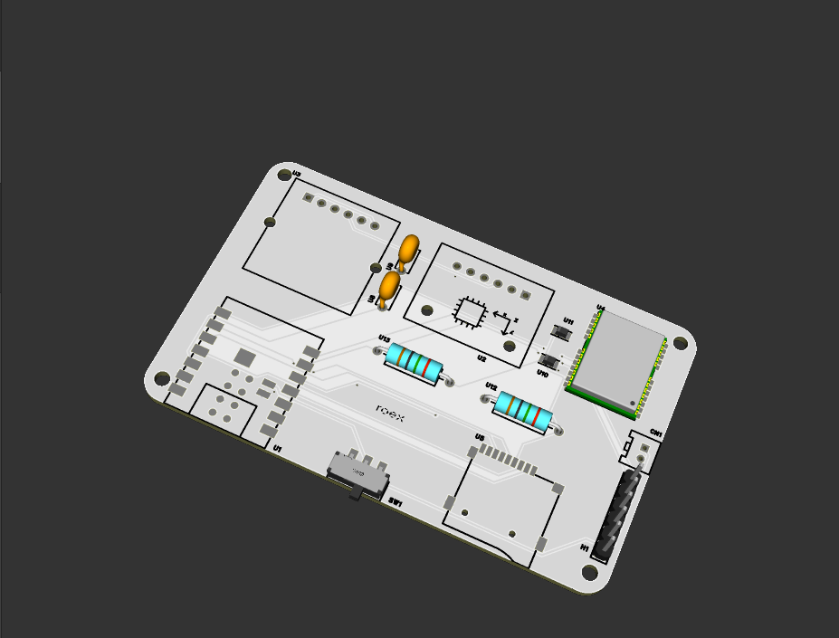
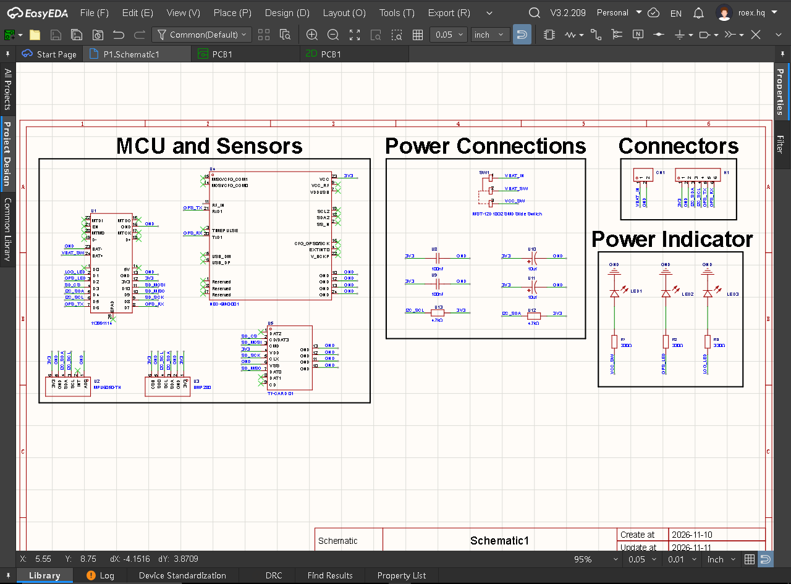
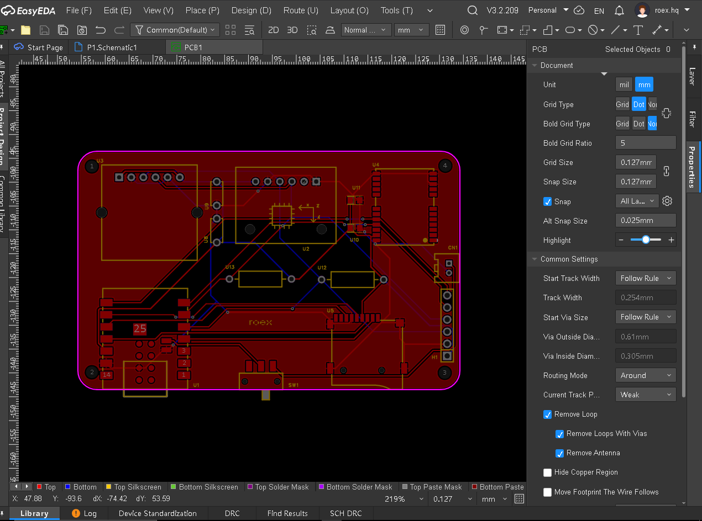
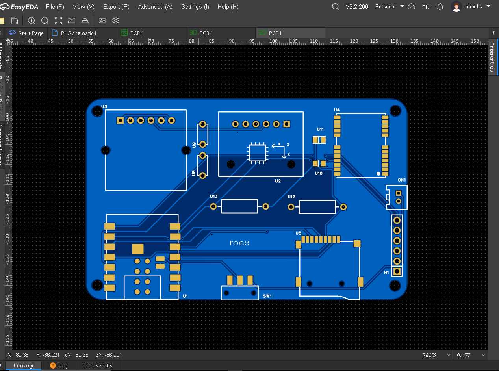
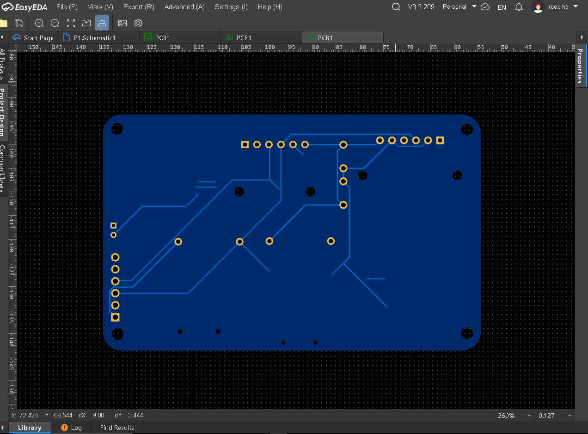
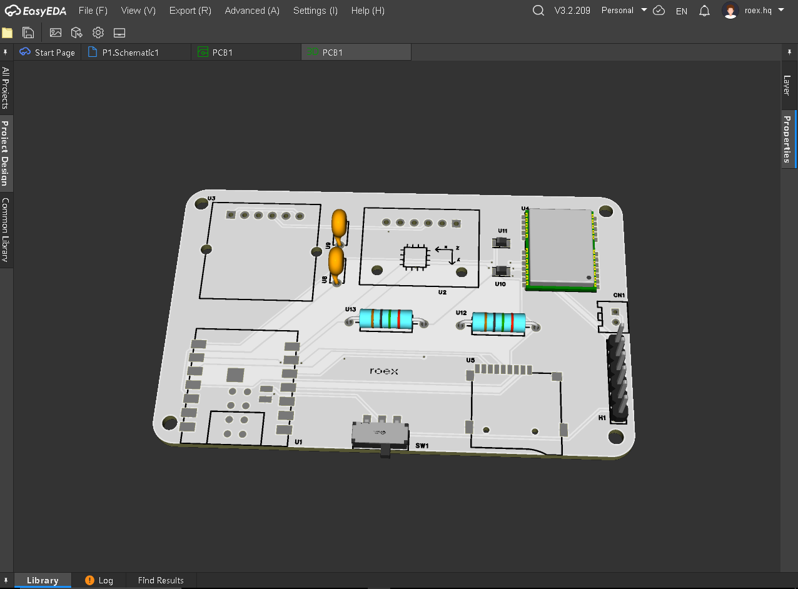
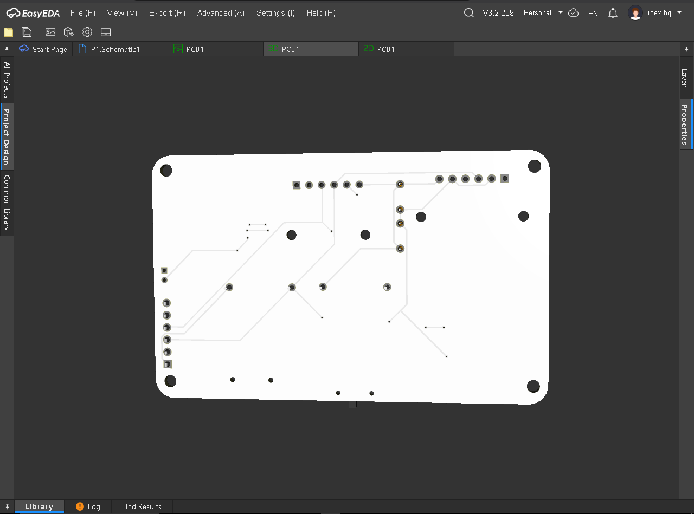

This is a Mini Rocket Flight Computer which is installed inside of the rocket its record the performance of the rocket when it is launching with the help of XIAO ESP32-S3 main controller and sensors like MPU6050 for accleration of the rocket and BMP280 for pressure measurment, also store all flight data in sd card spi module simply a prototype of a fight computer.the BOM of this project is written as below

| Part | Type | Quantity | Unit price (USD) | Line total (USD) | Link | Vendor | Funding | Notes |
| :--- | :--- | :--- | :--- | :--- | :--- | :--- | :--- | :--- |
| Seeed Studio XIAO ESP32-S3 | Part | 1 | 16.27 | 16.27 | https://digilog.pk/products/seeed-studio-xioa-esp32-s3?_pos=1&_sid=4ce5143a3&_ss=r | Digilog.pk | Grant | Main Microcontroller |
| MPU6050 Accelerometer/Gyro | Part | 1 | 1.41 | 1.41 | https://digilog.pk/products/gy521-mpu6050-3-axis-digital-gyroscope-accelerometer-sensor-module?_psq=mpu6050&_psid=2202fde74 | Digilog.pk | Grant | I2C IMU sensor |
| BMP280 Barometric Pressure Sensor | Part | 1 | 0.58 | 0.58 | https://digilog.pk/products/bmp280-barometric-pressure-sensor-module-in-pakistan-www-hallroad-org?_psq=bmp280&_psid=07264f650 | Digilog.pk | Grant | Altitude estimation |
| NEO-6M GPS Module | Part | 1 | 3.65 | 3.65 | https://digilog.pk/products/gps-module-neo6m-v2-u-blox?_psq=NEO-6M+GPS+Module&_psid=9767c06a2 | Digilog.pk | Grant | Flight position tracking |
| MicroSD Card Module | Part | 1 | 0.58 | 0.58 | https://digilog.pk/products/arduino-sd-card-reader-module-in-pakistan?_psq=MicroSD+Card+Module&_psid=35cfd906c | Digilog.pk | Grant | SPI Data logging storage |
| SMD Slide Switch | Part | 1 | 0.072 | 0.072 | https://digilog.pk/products/3-pin-2-position-panel-mount-micro-vertical-slide-switch-high-knob-in-pakistan?variant=44490762420502 | Digilog.pk | Grant | Power ON/OFF switch |
| 100nF Capacitors | Part | 1 | 0.036 | 0.036 | https://digilog.pk/products/100nf-capacitor-104-capacitor-0-1uf-capacitor-in-paksitan?_psq=100nF+Decoupling+Capacitors&_psid=53c6c21d9 | Digilog.pk | Grant | Power decoupling |
| 10µF Capacitors | Part | 1 | 0.036 | 0.036 | https://digilog.pk/products/10uf-16v-radial-electrolytic-capacitor-in-pakistan?_psq=10%C2%B5F+Filtering+Capacitors&_psid=5a4f72035 | Digilog.pk | Grant | Power filtering |
| 4.7kΩ I2C Resistors | Part | 1 | 0.00 | 0.00 | | | Already own | I2C bus pull-ups |
| 2 Pin JST Ph Connector | Part | 1 | 0.072 | 0.072 | https://digilog.pk/products/2-pin-jst-ph-connector-2-0mm-pitch-in-pakistan?variant=44486587187478 | Digilog.pk | Grant | Battery input connector |
| shipping | Shipping | 1 | 1.27 | 1.27 | | | Grant | |
| **Total** | | | | **23.976** | | | | |

---

## Banner 

project overview banner
##  Schematic

system circuit schematic diagram
##  PCB Layout

routed PCB trace layout
##  2D Board Redered

top layer 2D board render
##  Backview of 2D Board Redered

bottom layer 2D board render
##  3D Board Redered

Made by Abdul Rafay
top 3D board model
##  Backview of 3D Board Redered

bottom 3D board model
